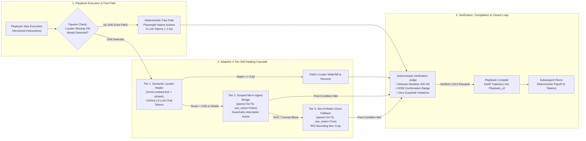
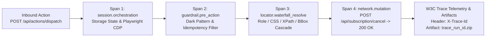

# Design & Architecture: Driftless-Playwright Execution Runtime

> Architectural specifications, execution state machines, multi-tier self-healing flows, and OpenTelemetry distributed tracing design for the `driftless-playwright` runtime.

---

## 🏛️ Driftless-Playwright Embedded Banking Infrastructure

```mermaid
flowchart LR
    subgraph BANK ["Digital Banking Portal (Apex Digital Bank)"]
        direction TB
        B1["Bank Consumer (Alex Chen)\n• Account Balance: $8,452.19\n• Connected Subscriptions: 7 Active\n• StreamPulse Ultra 4K ($22.99/mo)"]
        B2["User Action Trigger\n• Tap: 'Cancel Subscription'\n• Zero-Trust Session Token Issued"]
        B1 --> B2
    end

    subgraph INFRA ["Driftless-Playwright Embedded Banking Infrastructure"]
        direction LR
        subgraph P1_BOX ["1. IDENTIFY RECURRING BILLS"]
            P1["• Live Merchant DOM Ingestion\n• Plan Tier & Pricing Extraction ($22.99/mo)\n• Billing Cadence: Monthly / Annual\n• Renewal Date Target: 2026-11-01\n• Linked Card: Visa •••• 1111\n• RecurringBillDescriptor Schema"]
        end

        subgraph P2_BOX ["2. UNDERSTAND & AUDIT CHARGES"]
            P2["• Silent Price Hike Detection (+ $3.00/mo)\n• Baseline Delta vs Banking Transactions\n• Contract Terms & Cancellation Policy Audit\n• Dark-Pattern & Retention Trap Risk Scoring\n• Consumer-Facing Plain English Summary"]
        end

        subgraph P3_BOX ["3. MANAGE & TAKE ACTION (IRIS)"]
            P3["• Action A: 1-Click Virtual Card Swap\n• Action B: Dark-Pattern Resilient Cancellation\n• Action C: Automated Bill Savings & Promo Codes\n• Action D: Plan Tier Downgrades\n• Action E: Billing Cycle Pauses\n• Iris Autonomous Browser Takeover"]
        end

        P1_BOX ==> P2_BOX ==> P3_BOX
    end

    subgraph SETTLE ["Verification & Banking Feedback"]
        direction TB
        V1["Compliance Verification\n• POST /api/subscription/cancel -> 200 OK\n• Verified DOM Confirmation Badge\n• 0 Policy Violations (Blocked $199 Trap)\n• Cryptographically Signed Receipt"]
        V2["Bank Core Settlement\n• Status: Canceled in Banking App\n• Annual Savings Logged: $275.88\n• Instant Mobile Push Notification\n• Transaction Baseline Updated"]
        V1 --> V2
    end

    B2 ==> P1_BOX
    P3_BOX ==> V1
```



---

## 🏗️ Architecture & Component Design

The runtime balances deterministic sub-second speed with adaptive multi-agent resilience:



### Component Breakdown

1. **Contextual Bandit Router ([`PlaybookRouter`](./driftless_playwright/router.py#L20)):**
   Selects the optimal version of a merchant playbook based on historical win-rate, latency penalty, and matching DOM fingerprint:
   $$\text{strategy\_score} = \frac{\text{success\_count}}{\max(1, \text{attempt\_count})} - 0.05 \cdot \text{avg\_latency\_sec}$$

2. **Step Orchestrator ([`ResilientStepOrchestrator`](./driftless_playwright/router.py#L52)):**
   Executes individual `StepAnchor` records in the playbook. Monitored by the 4-level Ranked Locator Waterfall before declaring drift.

3. **4-Level Ranked Locator Waterfall ([`LocatorResolver`](./driftless_playwright/locator_waterfall.py#L31)):**
   - **Priority 1:** Accessible Role + Accessible Name (`role=button[name='Cancel'i]`)
   - **Priority 2:** Stable Semantic Attributes (`css=[data-testid='cancel-btn']`)
   - **Priority 3:** Text-Anchored Relative XPath (`xpath=//section[contains(.,'Billing')]//button`)
   - **Priority 4:** Bounding Box Proximity (`bbox=[x, y, w, h]`)

4. **3-Tier Adaptive Self-Healing Cascade ([`driftless_playwright.agents`](./driftless_playwright/agents.py)):**
   - **Tier 1 (Fast Semantic):** Cosine embedding similarity + visual pHash (`Score = 0.45 * CosineSim + 0.25 * RoleMatch + 0.20 * pHashSim + 0.10 * BBoxProximity`). Patches selectors in `<100ms` with 0 LLM chat tokens.
   - **Tier 2 (Scoped Micro-Agent Bridge):** Scoped `qwen2.5vl:7b` (`use_vision=False`) navigating dark-pattern retention modals and surveys.
   - **Tier 3 (Set-of-Marks Vision Grounding):** Region of Interest (ROI) image crops for unlabeled SVGs and canvas controls.

5. **Closed-Loop Experience Distillation ([`PlaybookCompiler`](./driftless_playwright/compiler.py#L18)):**
   Synthesizes winning agentic trajectories into persistent `Playbook_v2` JSON schemas so subsequent executions run on the deterministic fast path.

---

## 🔭 Observability & OpenTelemetry (o11y) Architecture

Following production OpenTelemetry distributed tracing standards:



### Dedicated Observability Endpoints

| Method | Endpoint | Description |
| :--- | :--- | :--- |
| `GET` | `/health` | Health check returning service status, uptime seconds, and active tracing status. |
| `GET` | `/api/v1/telemetry/stats` | Returns OpenTelemetry latency percentiles (`P50`, `P95`, `P99`), throughput, and recent traces. |
| `GET` | `/api/v1/telemetry/spans` | Returns microsecond-precision execution spans with W3C `trace_id` and `span_id`. |
| `GET` | `/dashboard` | Interactive dark-mode Flight Recorder dashboard with live KPI gauges and diff views. |

### Distributed Trace Propagation

Every response propagates the active OpenTelemetry trace ID:

```http
HTTP/1.1 200 OK
Content-Type: application/json; charset=utf-8
X-Trace-Id: 4bf92f3577b34da6a3ce929d0e0e4736
```

### Telemetry Flight Recorder Control Plane

The Flight Recorder ([`TelemetryFlightRecorder`](./driftless_playwright/telemetry.py#L18)) maintains:
- Rolling trace history and span metadata.
- P50, P95, and P99 latency percentiles across deterministic vs. agentic executions.
- Downloadable Playwright trace archives (`trace_<run_id>.zip`) and screenshot receipts.
- Live visual diffs showing healed selectors and confidence metrics.

---

## Related Documentation

- **[README.md](./README.md):** Main project overview, quickstart, and interactive showcase demo.
