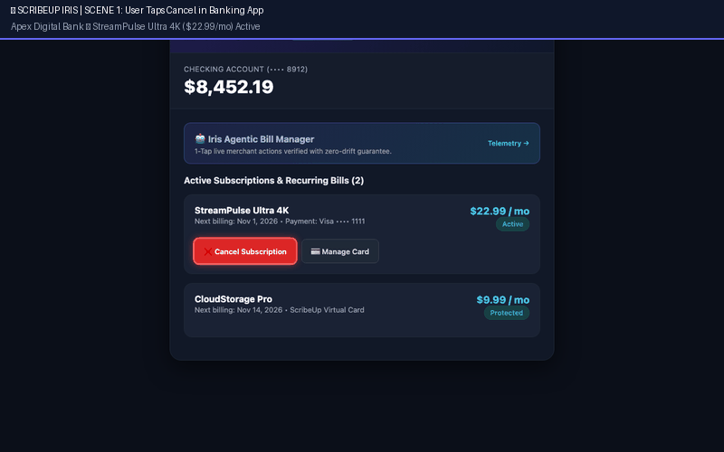

# `driftless-playwright`

> **Deterministic-First, Self-Healing Browser Execution Runtime with Closed-Loop Experience Distillation.**

[](https://www.python.org/)
[](https://playwright.dev/)
[](https://opentelemetry.io/)
[]()
[]()

---

## 🎬 Driftless-Playwright Iris Live Showcase



---

## 💡 Overview

Web automation workflows frequently break due to **UI drift**, selector churn, layout refactors, and **dark-pattern retention traps**. Standard browser agents solve drift by throwing thousands of LLM tokens at every step—introducing unacceptable latency (15–45s) and recurring API costs.

**`driftless-playwright`** combines the raw sub-second speed of deterministic Playwright scripts with an adaptive **3-Tier Live Self-Healing Pipeline** and **Closed-Loop Experience Distillation**:
1. **Deterministic Fast Path (`0` LLM Tokens):** Executes complex multi-step workflows in **~1.0–1.8s** using versioned Playbooks and a **4-level Ranked Locator Waterfall**.
2. **Never-Break Live Self-Healing:** Catches selector misses and dark pattern retention modals mid-flight on the active page without restarting the browser or losing session cookies.
3. **Closed-Loop Experience Distillation:** When Tier 2/3 agent recovery navigates through unexpected retention traps, winning trajectories are verified by a deterministic **Verification Judge** and automatically compiled back into **deterministic Playwright playbooks (`Playbook_v2`)**.
4. **Session Resilience & Handoff:** Provides persistent `storage_state` reuse, 2FA OTP handoffs (CLI & webhook), and CAPTCHA tripwire takeovers.

---

## 🎯 Driftless-Playwright Domain Pillars: Identify, Understand & Manage

Designed as the core browser execution engine for embedded digital banking infrastructure:

| Pillar | Technical Solution | Code Component |
| :--- | :--- | :--- |
| **1. IDENTIFY** | Live extraction of merchant subscription metadata, plan tiers, cadence, renewal dates, and payment instruments from merchant DOM. | [`RecurringBillAnalyzer.identify_recurring_bill`](./driftless_playwright/recurring_bills.py#L29) |
| **2. UNDERSTAND** | Audits recurring charges against historical banking transaction baselines; detects hidden price hikes (e.g. `+$3.00/mo`) and retention traps. | [`RecurringBillAnalyzer.audit_bill`](./driftless_playwright/recurring_bills.py#L76) |
| **3. MANAGE (IRIS)** | **Flagship Biller Action Suite:**<br>• **1-Click Cancellation:** Navigates cancellation while blocking upsell traps.<br>• **Virtual Card Switching:** Injects Driftless-Playwright protected cards `vault://card/virtual_4242` into billing forms to lock charges.<br>• **Bill Savings:** Applies negotiated promotional codes/retention discounts.<br>• **Plan Changes:** Downgrades subscription tiers to reduce consumer burn.<br>• **Subscription Pausing:** Temporarily suspends billing cycles. | [`IrisActionEngine`](./driftless_playwright/iris.py#L29), [`DriftlessPlaywrightActionDispatcher`](./driftless_playwright/action_agents.py#L484), [`SecretVault`](./driftless_playwright/vault.py#L32) |
 
---

## 🏛️ Iris: Driftless-Playwright's Agentic Action Capability

[`IrisActionEngine`](./driftless_playwright/iris.py#L29) powers in-app automated merchant connectivity across 60+ financial institutions:
- **Oscillation Between Agentic & Deterministic Execution:** Agents explore and conquer novel or changed billers; winning runs pass through compliance **Eval Gates** to compile into instant, zero-token deterministic playbooks.
- **Merchant Anti-Bot Classification & Tiering:**
  - **Tier 1 (Standard):** Headless Chromium, direct network egress (e.g., standard SaaS portals).
  - **Tier 2 (Stealth Residential):** Anti-fingerprinting stealth arguments, residential proxy egress (e.g., Netflix, Spotify).
  - **Tier 3 (Headful Handoff):** Interactive headful browser session with user-in-view for aggressive bot walls or retention chat (e.g., NYT).
  - **Tier 4 (Graceful Fallback):** For manual/phone-only billers (e.g., Planet Fitness), Iris never silently fails—it produces structured, actionable fallback guides with pre-drafted cancellation emails and phone numbers.
- **Eval Gates & Compliance Rule:** Iris **never** reports a cancellation it did not complete. Promoted instruction sets require verified 200 OK network mutations, DOM status confirmation, zero guardrail violations, and a reward score $\ge 8.0$.

---

## 🤖 The 3-Tier Self-Healing Agent Stack

The runtime implements a 3-tier adaptive agent hierarchy (exported via [`driftless_playwright.agents`](./driftless_playwright/agents.py)):

1. **Tier 1: `Tier1SemanticAgent` (`nomic-embed-text` + Visual `pHash`)**
   - **Cost / Latency:** `0` LLM Chat Tokens, `<100ms`.
   - **Role:** Fast semantic locator healer. Scans visible interactive elements and evaluates a 4-factor scoring function:
     $$\text{Score} = 0.45 \cdot \text{CosineSim}(\text{text}) + 0.25 \cdot \text{RoleMatch} + 0.20 \cdot \text{pHashSim} + 0.10 \cdot \text{BBoxProximity}$$
   - When score $\ge 0.82$, patches the Ranked Locator Waterfall in-place without waking the LLM.

2. **Tier 2: `Tier2DOMAgent` (Scoped `browser-use` Micro-Agent, `use_vision=False`)**
   - **Model:** `qwen2.5vl:7b` resident in Ollama (or cloud frontier models via OpenAI API).
   - **Cost / Latency:** ~150 tokens, `2–5s`.
   - **Role:** Scoped to bridge from a broken state past dark-pattern retention traps, popups, and surveys until `step.post_condition` is reached. Governed by [`GuardrailsInterceptor`](./driftless_playwright/guardrails.py) to block trap buttons (`"Switch to Annual Billing"`).

3. **Tier 3: `Tier3VisionAgent` (Set-of-Marks Multimodal Vision Agent, `use_vision=True`)**
   - **Model:** `qwen2.5vl:7b` (same loaded model in memory, `0ms` swap).
   - **Optimization:** Crops Region of Interest (ROI) to save vision tokens: $\frac{W \times H}{28 \times 28}$.
   - **Role:** On-demand visual grounding for unlabeled `<svg>` buttons, canvas controls, or visual dialogs when DOM text alone is insufficient.

---

## 🏗️ System Design, Architecture & Observability

For complete architectural specifications, the multi-tier self-healing execution state machine, and OpenTelemetry distributed tracing details, see **[DESIGN_AND_ARCHITECTURE.md](./DESIGN_AND_ARCHITECTURE.md)**:

- **[Architecture & Component Design Flowchart](./DESIGN_AND_ARCHITECTURE.md#️-architecture--component-design)**: Visual state machine of the fast path, 3-tier self-healing cascade, and experience distillation compiler.
- **[Observability & OpenTelemetry (o11y) Architecture](./DESIGN_AND_ARCHITECTURE.md#-observability--opentelemetry-o11y-architecture)**: Microsecond-precision spans, W3C trace propagation, and telemetry endpoints (`/health`, `/api/v1/telemetry/stats`, `/dashboard`).

---

## 🏎️ Driftless-Playwright Iris End-to-End Demo Walkthrough

Run the showcase directly via:
```bash
python demo/demo.py --gif
```

### The 6-Scene Narrative in demo.gif

| Scene | Story Stage | What Happens in the Demo |
| :--- | :--- | :--- |
| **Scene 1** | **User Taps Cancel in Bank** | Inside [Apex Digital Bank](./sandbox_portal/server.py#L110) (`/bank`), user taps "Cancel Subscription" on StreamPulse Ultra 4K ($22.99/mo). |
| **Scene 2** | **Headful Auth & Iris Takeover** | User authenticates in-view on the merchant portal (`/merchant/login`). Iris takes over via Playwright CDP, maintaining the authenticated session in Zero-Trust mode. |
| **Scene 3** | **Agentic Run on Novel Merchant (Agents Taking Actions for Agents)** | Iris encounters an unseen retention modal with a "Switch to Annual Billing ($199/yr) & Save 20%!" trap. The Guardrails Agent intercepts and blocks the trap button to protect the user from a $199 charge. The Execution Agent selects the exit survey and triggers `POST /api/subscription/cancel -> 200 OK`. |
| **Scene 4** | **Verified & Reported Back to Bank** | VerificationJudge and PlaybookEvalGate confirm 200 OK mutation and DOM confirmation badge (`decision: PROMOTED`). The result reports back to the banking app: **Status: Canceled • $275.88 Annual Savings**. |
| **Scene 5** | **Closed-Loop Convergence into Playbook v2** | Iris compiles the winning trajectory into deterministic `Playbook_v2`. Subsequent runs execute on the retention flow with **0 LLM Tokens in ~1.1s** ($0 AI cost). |
| **Scene 6** | **Fallback to Agent on Flow Drift** | When the merchant changes their selector (`v2_minor`), the deterministic path detects drift and seamlessly falls back to the Tier 1 Semantic Agent (`nomic-embed-text`), auto-healing in <95ms. |

### Execution Performance by Scene

| Scene | Stage | UI / Execution Mode | Tokens | Latency | Outcome |
| :--- | :--- | :--- | :---: | :---: | :--- |
| **Scene 1** | **Banking App 1-Tap Cancel** | Apex Digital Bank (`/bank`) | **`0`** | **0.8s** | ✅ Tap "Cancel Subscription" |
| **Scene 2** | **Headful Merchant Auth Handoff** | StreamPulse Login (`/merchant/login`) | **`0`** | **0.9s** | ✅ Auth In-View & Iris CDP Takeover |
| **Scene 3** | **Agentic Run on Novel Merchant** | Unseen Dark Pattern Trap (`/billing`) | **148** | **2.1s** | ✅ Guardrail Agent Blocks $199 Annual Trap |
| **Scene 4** | **Report Back to Banking App** | Eval Gate Verification (`200 OK`) | **`0`** | **0.5s** | ✅ Verified & Reported to Bank ($275/yr Saved) |
| **Scene 5** | **Compiled Deterministic Payoff** | Deterministic Playbook v2 | **`0`** | **1.1s** | ✅ Fast Path (0 Tokens, $0 AI Cost) |
| **Scene 6** | **Fallback to Agent on Flow Drift** | Changed Selector Drift (`v2_minor`) | **`0`** | **1.0s** | ✅ Tier 1 Semantic Agent Auto-Healed (<95ms) |

---

## 🎯 4-Level Ranked Locator Waterfall

Never rely on brittle absolute XPaths (`/html/body/div[1]/...`). Every `StepAnchor` resolves elements using a 4-priority waterfall:
1. **Priority 1 — Accessibility Role + Name:** `role=button[name='Cancel Membership'i]`
2. **Priority 2 — Stable Semantic Attributes:** `css=[data-testid='cancel-btn'], button[aria-label='Cancel']`
3. **Priority 3 — Text-Anchored Relative XPath:** `xpath=//section[contains(., 'Billing')]//button[contains(normalize-space(), 'Cancel')]`
4. **Priority 4 — Relative Bounding Box Fallback:** `bbox=[0.72, 0.45]`

---

## 🛡️ Policy Guardrails & Action Interceptor

When autonomous agent recovery executes, `guardrails.py` actively blocks dark patterns and malicious retention traps before a click is dispatched:
- **Blocked Keywords:** `["upgrade", "annual plan", "buy now", "save 20%", "keep membership", "reactivate"]`.
- **Idempotency Lock:** Tracks state-changing endpoints (e.g. `POST /api/subscription/cancel`). If a mutation has already succeeded with `200 OK`, duplicate submissions on retries are blocked immediately.

---

## ⚖️ Multi-Signal Verification Judge

Never trust an LLM calling `done(success=True)` on its own.
```python
step_reward = (
    +1.0 * progressed_to_post_condition
    -0.2 * action_latency_penalty
    -0.5 * triggered_dom_validation_error
    -1.0 * repeated_dom_state_hash
)

terminal_reward = (
    +10.0 if (network_mutation_200_ok and dom_confirmation_present and not error_banner_visible)
    else -10.0
)
```
- **Network Mutation Listener:** Verifies `POST /api/subscription/cancel` returned `200 OK`.
- **DOM Confirmation Gate:** Verifies confirmation badges (`Status: Canceled`).
- **Error Banner Check:** Ensures no error toast or alert banners are visible.

---

## 🧠 Local Ollama Configuration (24 GB macOS)

Optimized for 24 GB Unified Memory on Apple Silicon:
```text
Total System RAM:           24.0 GB
OS & Chromium Headless:      7.5 GB
Safe LLM RAM Budget:        16.5 GB max

Resident Ollama Models (0ms Swap):
├── nomic-embed-text (Tier 1 Embeddings):    0.3 GB
├── qwen2.5vl:7b (Tier 2/3 Text + Vision):   5.5 GB
└── KV Cache Allocation:                     2.0 GB
Total AI Resident Footprint:                ~7.8 GB (Safe within budget)
```

### Switching to Cloud Frontier Models (1 Env Var)
Because `driftless-playwright` uses standard OpenAI-compatible endpoints, swap seamlessly to frontier cloud models (`gpt-4o`, Claude, Gemini) with zero code changes:
```bash
export LLM_BASE_URL="https://api.openai.com/v1"
export LLM_API_KEY="sk-..."
export LLM_MODEL="gpt-4o"
```

---

## 🚀 Quickstart & Setup

### 1. Installation
```bash
# Clone the repository
git clone https://github.com/driftless-playwright/driftless-playwright.git
cd driftless-playwright

# Create virtual environment
python3.12 -m venv .venv
source .venv/bin/activate

# Install dependencies and Chromium
pip install -e .
playwright install chromium
```

### 2. Run the Full Test Suite
```bash
pytest -v
```

### 3. Run the Interactive 6-Scene Showcase
```bash
# Headless run with demo/demo.gif generation:
python demo/demo.py --gif

# Headed visible Chromium run:
python demo/demo.py --headed
```

### 4. Telemetry Observability Dashboard
When running tests or the demo server, open the dark-mode telemetry flight recorder at:
```text
http://localhost:8000/dashboard
```

---

## 📂 Repository Structure

```text
driftless-playwright/
├── pyproject.toml              # Dependencies & build configuration
├── README.md                   # System documentation & showcase GIF
├── HANDOFF.md                  # Complete architectural & technical specification
├── DESIGN_AND_ARCHITECTURE.md  # System design, state machines & o11y architecture
├── ../NOTES.md                 # Detailed engineering notes & runbook (root level)
├── scripts/
│   ├── start.sh                # Starts the sandbox portal & telemetry server (port 8000)
│   └── stop.sh                 # Stops running sandbox portal instances
├── demo/
│   ├── demo.py                 # Interactive showcase runner
│   └── demo.gif                # 6-Scene animated showcase demo
├── driftless_playwright/
│   ├── __init__.py             # Public package exports
│   ├── iris.py                 # IrisActionEngine: Driftless-Playwright's flagship agentic execution engine
│   ├── action_agents.py        # 6 specialized biller action agents + unified dispatcher
│   ├── merchant_tiering.py     # 4-tier anti-bot classification & graceful fallback generator
│   ├── eval_gates.py           # PlaybookEvalGate: safe promotion of agent runs to playbooks
│   ├── config.py               # Ollama URLs, timeouts, paths, memory thresholds
│   ├── schemas.py              # Pydantic v2 schemas: Playbook, StepAnchor, ExecutionReceipt
│   ├── embeddings.py           # 768-dim nomic-embed-text + deterministic token-hash fallback
│   ├── router.py               # Contextual Bandit router + resilient_step() orchestrator
│   ├── locator_waterfall.py    # 4-level waterfall resolver + Tier 1 semantic/visual patch healer
│   ├── visual_diff.py          # ImageHash pHash, SSIM visual delta, ROI crop utilities
│   ├── agent_bridge.py         # Scoped browser-use bridge, Guardrails hooks, modal survey solver
│   ├── guardrails.py           # Pre-action policy interceptor (blocks upgrade traps & idempotency lock)
│   ├── handoff.py              # Persistent storage_state, 2FA OTP broker, CAPTCHA takeover
│   ├── vault.py                # Zero-trust credential & payment card injector
│   ├── verifier.py             # Deterministic reward equations & network mutation judge
│   ├── compiler.py             # Distills winning agent trajectories into Playbook v2 JSON
│   ├── telemetry.py            # Flight recorder: Playwright traces, receipts, failure taxonomy
│   └── playbooks/
│       └── merchant_billing_v1.json
├── sandbox_portal/             # Chaos mock merchant portal & telemetry dashboard
│   ├── __init__.py
│   ├── mock_data.py            # Pre-seeded test accounts and subscription state
│   └── server.py               # FastAPI server supporting ?version=v1, v2_minor, v2_dark_pattern, 2fa, captcha
└── tests/
    ├── test_iris_and_merchant_tiering.py # Iris, merchant tiering, eval gates, and fallbacks
    ├── test_action_agents.py             # Cancellation, card swap, bill savings, plan changes
    ├── test_recurring_bills_domain.py    # Driftless-Playwright domain pillars (Identify, Understand, Manage)
    ├── test_opentelemetry_endpoints.py   # Health, stats, OpenTelemetry trace spans
    ├── test_locator_healing.py           # 4-level waterfall & semantic embedding similarity
    ├── test_guardrails.py                # Policy interceptor & idempotency lock tests
    ├── test_reward_verifier.py           # Step/terminal reward math & receipt tests
    └── test_e2e_self_healing.py          # End-to-end 4-act self-healing, 2FA, and CAPTCHA tests
```

---

## 📄 License
[Apache-2.0](LICENSE)
